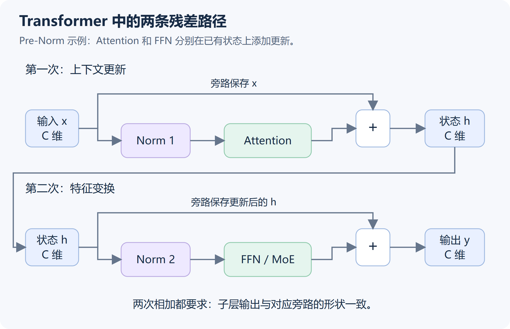
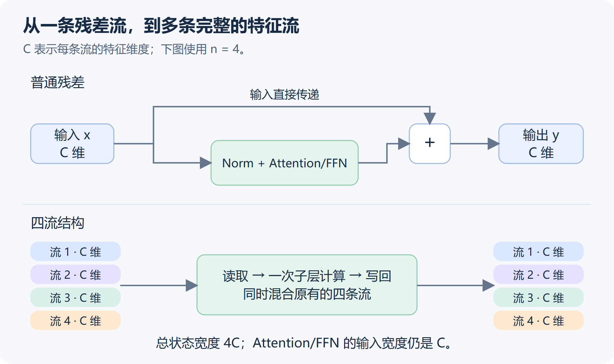
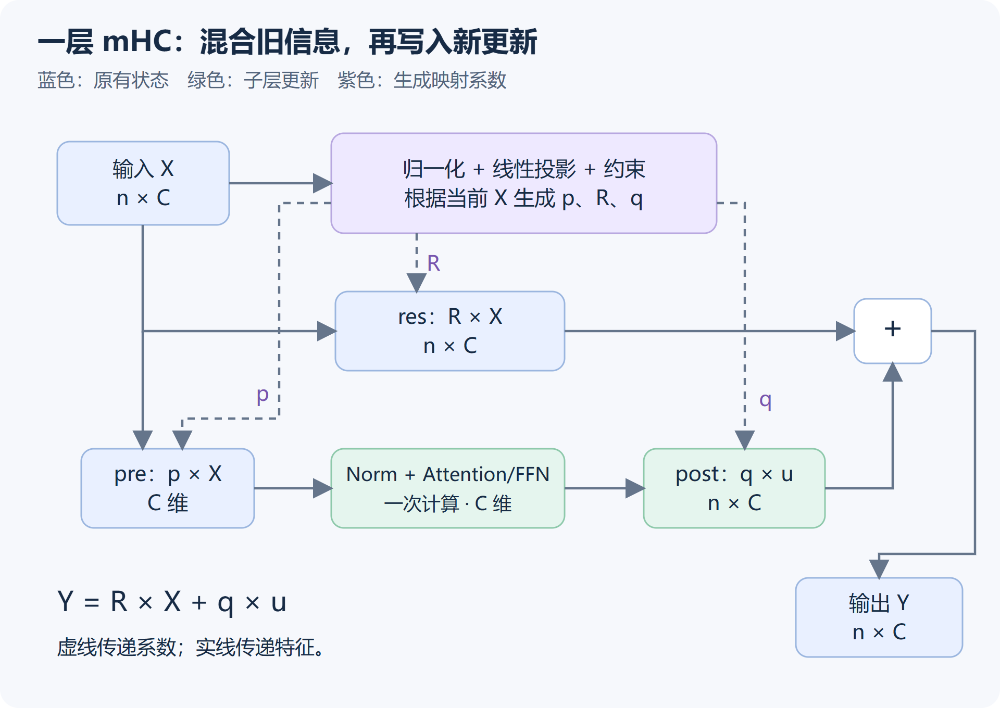
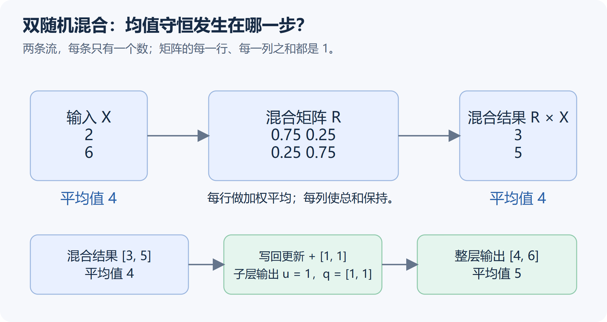
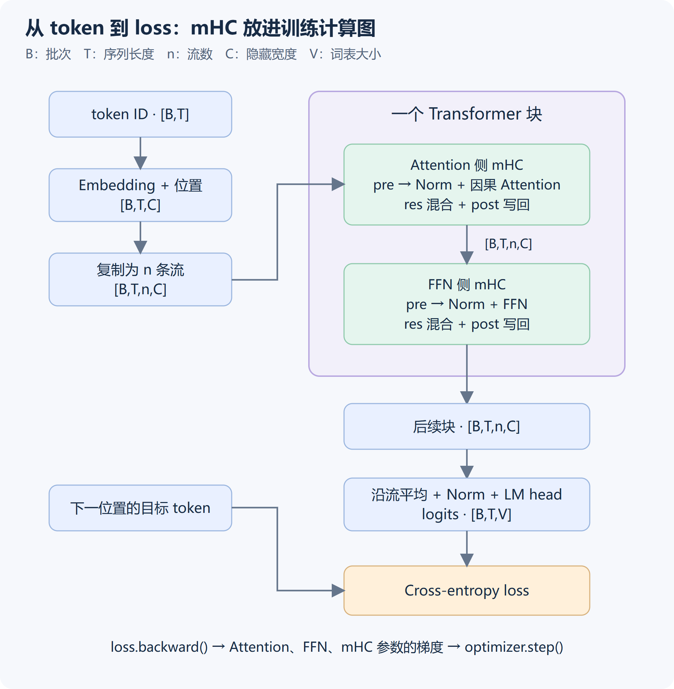

# 从残差连接到 mHC：原理、Transformer 接入与训练实践

一层神经网络处理完输入后，下一层收到什么？在常见的残差结构里，答案是：**原来的信息，加上这一层算出的更新。** mHC 把沿途传递的信息扩展成多条流，再学习如何读取、混合和更新它们。

mHC 的全称是 **Manifold-Constrained Hyper-Connections，流形约束超连接**。Hyper-Connections 指对连接方式的扩展；“残差”的英文是 residual。它改变的是 Attention、FFN 等子层之间的信息传递方式。

## 1. 普通残差：保留输入，再加一份更新

设输入是 x，这一层计算出的更新是 F(x)，残差连接得到：

$$
y=x+F(x)
$$

例如，输入是 `[2, 3]`，更新是 `[0.1, -0.2]`，输出就是 `[2.1, 2.8]`。相加发生在对应元素之间。这样一来，某层即使暂时只能给出很小的更新，原来的信息也能继续向后传。

“残差”可以从目标变换来理解：若希望整层实现 H(x)，把它写成 x+F(x)，计算分支承担的就是相对输入的变化 F(x)=H(x)-x。训练仍由最终任务的损失驱动，并不需要另外提供一份“残差标签”。

### 一个 Transformer 块里，通常有两次残差相加

以常见的 decoder-only、Pre-Norm Transformer 为例，一个块先做 Attention，再做 FFN。Norm 表示归一化，Pre-Norm 表示把它放在计算分支的入口。**两个子层各有一条残差连接**；以下公式省略 Dropout 等细节：

$$
h=x+\operatorname{Attention}(\operatorname{Norm}_1(x))
$$

$$
y=h+\operatorname{FFN}(\operatorname{Norm}_2(h))
$$

这里的 x、h、y 是同一组 token 在三个计算位置的状态。用 C 表示每个 token 的隐藏向量长度，输入张量通常包含 batch、序列和特征三个维度；残差相加前，两侧形状必须一致。



*图 1：Attention 的残差保存 x，FFN 的残差保存 Attention 更新后的 h。每次相加都发生在相同 token、相同特征位置上。*

Attention 根据上下文聚合信息，经输出投影后回到隐藏维度 C。FFN 对各 token 的特征做非线性变换；它的中间维度可以比 C 大，但最后也投影回 C。所以两次更新都能和旁路中的状态逐元素相加。采用 MoE 时，专家选择和专家计算改变的是 FFN 分支内部，外面的残差仍可保留。

例如，对某个 token，Attention 前的状态是 `[2, 3]`。Attention 根据上下文产生更新 `[0.1, -0.2]`，相加后得到 `h = [2.1, 2.8]`。FFN 再给出更新 `[-0.05, 0.4]`，最终是 `y = [2.05, 3.2]`。这几个数只是便于演算的特征值；实际向量的各维通常没有预先指定的“语法”“含义”等标签。

### 前向：让每个子层在已有状态上继续加工

如果只把 F(x) 交给下一层，计算分支就要同时承担两项工作：保留后面仍然需要的信息，以及形成新的表示。残差让原有状态另有一条直接路径，计算分支可以在此基础上提供更新。

“更新”指计算分支的输出，不要求它一定很小，也不是训练前就给定的目标。训练通过最终损失同时调整 Attention、FFN 和其他参数，更新可以加强、削弱或抵消已有特征。某些情况下 F(x) ≈ −x，相加后也可能接近零，因此残差并不是把输入单独存进一个永远不会丢失的空间。

连续经过多个这种子层，状态可写成：

$$
x_L=x_0+\sum_{l=0}^{L-1}F_l(x_l)
$$

这个表达式中的 l 按每次残差更新计数，一个 Transformer 块通常贡献 Attention、FFN 两次更新；这里把计算分支的 Norm 也包含在 Fₗ 中。最初的 x₀ 仍直接出现在式子里，而每一项更新又依赖此前形成的状态。更深的层因而可以接着加工已有表示，无须每次完全重建它。

### 反向：损失对输入的梯度，有一份直接传回

训练时，损失函数衡量预测有多差。反向传播计算损失对各层状态、参数的梯度，也就是“它们变化一点，损失会怎样变化”。

先看只有一个数的例子。设后面传来的梯度是 g，F'(x) 表示计算分支 F 的输出对输入的变化率：

$$
\text{没有残差：}\quad g_{\mathrm{in}}=gF'(x)
$$

$$
\text{有残差：}\quad g_{\mathrm{in}}=g\bigl(1+F'(x)\bigr)
$$

若 g=1、F'(x)=0.01，两种情况分别得到 `0.01` 和 `1.01`。新增的 `1` 来自直接传递 x 的路径。对于向量，同样的关系写成单位矩阵与雅可比矩阵相加。

相加节点在反向传播时，把收到的梯度分别传给两条分支：旁路直接传回一份，计算分支还要经过 F 的导数，最后在输入处相加。更新分支较弱时，旁路仍提供梯度通道，帮助较浅层参与学习。[Identity Mappings in Deep Residual Networks](https://arxiv.org/abs/1603.05027) 分析了这种直接通路的作用。

前向传的是特征，反向传的是梯度。直接路径改善传播条件，但不保证所有方向上的梯度都稳定；两条分支的贡献仍可能抵消或放大。例如，反复执行 y=x+0.5x，前向数值和反向变化率都会持续增长。

### 归一化放在哪里，会改变这条直接路径

图 1 采用 **Pre-Norm**：先归一化计算分支的输入，再做子层计算，旁路中的 x 直接参与相加。原始 Transformer 使用的 **Post-Norm**，则在残差相加之后归一化：

$$
\text{Pre-Norm：}\quad y=x+F(\operatorname{Norm}(x))
$$

$$
\text{Post-Norm：}\quad y=\operatorname{Norm}(x+F(x))
$$

Post-Norm 的整体输出和梯度还要经过外层 Norm，因此前面的“原样旁路”公式不能不加区别地套到整个 Post-Norm 子层。Pre-Norm、Post-Norm 都使用残差，但直接通路的位置不同。原始结构见 [Attention Is All You Need，§3.1](https://arxiv.org/abs/1706.03762)，两种放置方式的训练分析见 [On Layer Normalization in the Transformer Architecture](https://arxiv.org/abs/2002.04745)。

残差负责把已有状态与新计算连接起来，归一化则调节送入计算的数值尺度，两者配合使用。图中的 Norm 可以是 LayerNorm 或 RMSNorm，具体由模型设计决定。

有了这个结构，mHC 的改动就更容易定位：**它把 Attention 外和 FFN 外的单流残差，分别扩展为多流的读取、混合与写回。**

## 2. 从残差到 HC：连接方式也可以学习

普通残差已经给信息和梯度提供了直接通路，为什么还要改？因为它同时固定了一种组织方式：每个子层都从同一条状态流读取，再把更新以系数 1 加回这条流。网络可以学习 Attention 和 FFN 的内容，连接本身却没有多少选择。

HC 把连接也变成学习对象。可以分两步理解这个变化。

这里还涉及“网络更深，表示是否真的更丰富”的问题：如果相邻深层的状态越来越相似，增加层数可能只带来很小的有效改变。HC 论文把这种现象与梯度传播的取舍作为动机之一。多流让网络能够保留和组合不同深度的更新，但最终收益仍需训练实验验证。

### 先让“保留多少、更新多少”可学习

把普通的 y=x+F(x) 推广为 y=ax+bF(x)，就能控制已有状态与本层更新各占多少。若 a=b=1，又回到普通残差。这说明残差是连接的一种特例。

但一条流仍只有一份状态。无论怎样调整 a,b，前面多层的结果最终都混在同一个向量里。HC 进一步扩大残差状态，让网络有多个位置保存不同的更新组合。

### 再从一份状态，扩成多份完整状态

Hyper-Connections（HC）给每个 token 保存 n 条流，每条仍是完整的 C 维向量，总状态宽度是 nC。例如 C=4096、n=4 时，保存四个 4096 维向量。子层先读取它们的加权组合，仍用一个 4096 维输入执行一次 Attention 或 FFN，再把结果写回各流。



*图 2：扩宽的是层间状态。Attention/FFN 的输入和输出宽度仍为 C；内部读写路径在图 3 展开。*

连接可以分成三个动作。下面用 pre、res、post 统一命名，便于从 HC 过渡到 mHC；HC 原论文还从深度连接、宽度连接的角度组织这些系数。

| 动作 | 读者可以问的问题 | 维度变化 |
| --- | --- | --- |
| pre：读取 | 当前子层应该读取哪些流，各占多少？ | n ×  C →  C |
| res：混合 | 原有各流怎样相互交换信息？ | n ×  C →  n ×  C |
| post：写回 | 本次算出的更新，给每条流写入多少？ | C →  n ×  C |

例如，两条流最初都是 x。第一个子层读取第一条流，得到更新 u₁；暂时不做流间混合，只把更新写入第一条，就得到 [x + u₁, x]。第二个子层可以读取尚未包含 u₁ 的第二条，形成自己的更新，也可以读取第一条，在 u₁ 的基础上继续加工。

这个例子说明多流提供了什么选择：**不同流可以保留不同的跨层更新组合，下一层再学习如何使用它们。** 实际系数通常是连续值，可以读取和写入多条流；每条流没有预先指定的语义标签。计算时各子层仍按程序顺序执行，不意味着自动并行运行多个 Attention。

### 静态 HC 与动态 HC

“可学习”与“随输入变化”还要分开看：

- **静态 HC**：连接系数本身是参数，训练时更新；一次前向中，各 token 使用相同的一组连接系数。
- **动态 HC**：网络根据当前 token 的多流状态生成系数。训练学习生成系数的参数，不同 token 可以得到不同的连接。

前者类似学习一套长期使用的配比，后者还会根据当前状态调整配比。[HC 原论文 §2–3 与附录 J](https://arxiv.org/html/2409.19606v3#S2) 给出了两种实现及其在 Transformer 中的接入方式。

### HC 的自由度，也带来了传播风险

普通残差的旁路是恒等映射：输入直接向后传。HC 的原有状态需要经过混合矩阵 R，跨越多层时就会连续相乘。例如，暂时忽略新增更新，两层后的状态是 R₂R₁X。

如果每次混合都近似乘以 2，经过 10 次就放大 2¹⁰ = 1024 倍；持续乘以 0.5 则不断衰减。这是解释机制的极端例子，不能据此断言每个 HC 模型都不稳定。

把 R 固定成单位矩阵，可以保留原样旁路，却又取消了流间交换。mHC 选择另一条路：**保留多流和可学习读写，让混合发生在一个受到约束的矩阵集合中。**

## 3. 一层 mHC 到底怎么算？

HC 与 mHC 使用相同的读取、混合、写回骨架；mHC 的主要区别在于如何生成和约束连接系数。

先看一个 token 的残差状态，把各流排成矩阵 X（n 行、C 列的实数矩阵）。令 p 是 pre 的 n 个系数，q 是 post 的 n 个系数，R 是 n ×  n 的残差混合矩阵。这里省略了 batch 和序列维度；Attention 仍会按模型的注意力规则读取序列中的其他位置。



*图 3：实线表示特征的流动，虚线表示当前输入生成的映射系数。Norm 是子层输入的归一化；生成映射的分支也有自己的归一化。*

三步可以写成：

$$
z=\sum_{j=1}^{n}p_jx_j,\qquad u=F(z),\qquad
y_i=\sum_{j=1}^{n}R_{ij}x_j+q_i u
$$

其中 F 把图中的输入归一化与 Attention 或 FFN 合起来表示。每条输出流都由两部分组成：**混合后的已有信息，以及按写回系数缩放的新更新。** pre 做加权求和，系数之和不要求为 1。

合在一起，就是 mHC 的单层形式：

$$
Y=RX+qF(pX)
$$

这里约定 p 是行向量，q 是列向量，Rᵢⱼ 表示“输入流 j 对输出流 i 的贡献”。某些实现按相反的下标顺序保存混合矩阵，因此使用转置再相乘；判断时应看每个维度的含义。

### 系数从哪里来？

mHC 为每个 token 生成动态映射：先把 X 展平成 nC 维，做 RMS 归一化和线性投影，再用可学习的缩放、偏置调整原始分数，最后施加约束。读取、写回、混合各有自己的分数。

当 n=4 时，投影产生 4+4+16=24 个原始数：4 个用于读取，4 个用于写回，16 个组成混合矩阵。训练学习的是投影权重、偏置和缩放参数；每次前向根据输入计算出具体系数。因此，存储的投影权重与最终的 4 × 4 混合矩阵是两种不同对象。[mHC 参数化公式，§4.2](https://arxiv.org/html/2512.24880v2#S4.SS2)。

## 4. mHC 的约束：让残差混合保持可控

为了约束前面提到的逐层混合，mHC 为残差混合矩阵 R 规定三个条件：

- 元素非负。
- 每一行的和为 1。
- 每一列的和为 1。

满足这些条件的矩阵叫作**双随机矩阵**。“随机”在这里是数学名称，不表示每次随机抽一个矩阵；矩阵仍由网络根据输入计算。

行和为 1，使每条输出流成为输入各流的加权平均；列和也为 1，则保持各流总和，进而保持它们的平均值。这里的总和与平均，是对**同一个 token、同一个特征维度上的 n 条流**计算的。仅做这种混合时，输出数值落在输入各流的最小值与最大值之间。

这些条件定义了允许使用的矩阵集合，也就是标题中“流形约束”的具体落点。这个集合通常称为 Birkhoff 多面体：学习可以在允许的集合中选择混合方式，约束本身不把混合系数固定成某个值。[mHC 论文 §4.1](https://arxiv.org/html/2512.24880v2#S4.SS1)。

pre 与 post 也有约束，但不要求系数之和为 1。论文采用 p = sigmoid(a)、q = 2 × sigmoid(b)，使读取、写回系数非负；sigmoid 把原始分数压到 0 与 1 之间。只有残差混合矩阵经过双随机归一化，上面的加权平均性质因此只适用于 RX。

### 为什么同时约束行和与列和？

看一个每行和为 1、但列和不为 1 的矩阵：

$$
R=\begin{bmatrix}1&0\\1&0\end{bmatrix},\qquad
R\begin{bmatrix}2\\6\end{bmatrix}=\begin{bmatrix}2\\2\end{bmatrix}
$$

两条输出都只读取第一条流。每条输出确实是加权平均，但所有输出加起来，把第一条输入用了两遍，第二条一次也没用。总和从 8 变成 4。

如果暂时把矩阵视为固定值，反向传播经过的是 Rᵀ：第一条输入会收集两条输出传回的梯度，第二条则收不到。**行约束管理每条输出如何读，列约束管理每条输入向所有输出分配的总量。** 双随机要求二者同时满足。

双随机也不等于只能“各留一半”。用 I 表示单位矩阵、P 表示两条流互换的矩阵，那么 I 表示各流保留自己，P 表示互换，而 0.75I+0.25P 表示保留与交换的组合。这样既允许交流，又保留一个可控的分配规则。

### 用两条流走完读取、混合与写回

取两条只有一个数的流：X = [2, 6]ᵀ，并使用：

$$
R=\begin{bmatrix}0.75&0.25\\0.25&0.75\end{bmatrix}
\quad\Longrightarrow\quad
RX=\begin{bmatrix}3\\5\end{bmatrix}
$$

第一条流得到 0.75 × 2+0.25 × 6=3，第二条流得到 5。混合前后平均值都是 4。

再补上计算分支：取读取系数 p=[0.25,0.75]，子层输入是 z=0.25 × 2+0.75 × 6=5。假设子层对此输入产生更新 u=F(z)=1，取写回系数 q = [1, 1]ᵀ，就分别给两条流加 1，得到 Y = [4, 6]ᵀ。这里的 u=1 是为了演示连接而给定的结果；真正模型中的更新由 Attention 或 FFN 计算。



*图 4：均值守恒适用于残差混合。图中取子层输出 u=1，两条流的写回系数都为 1，加入更新后均值从 4 变成 5。*

双随机矩阵还有一个有用的性质：多个这样的矩阵相乘，仍然满足同样的条件，因此仅沿残差混合路径跨越多层时，约束可以保持。

不过，**均值守恒不等于保留全部信息**。若把上面的矩阵换成所有元素都为 `0.5`，输出会变成 `[4, 4]`，两条流的差异就消失了。反向传播还要考虑 R 本身随输入变化，以及读取、子层计算和写回的导数；不能由双随机性质直接推断整层梯度一定稳定。

### Sinkhorn 怎样让约束真正成立？

神经网络输出的是任意实数分数，而不是天然满足条件的矩阵。先通过指数或 softmax 得到正数，再交替把每列、每行除以各自的和。这就是这里使用的 Sinkhorn 归一化。

为什么需要反复做？因为一次列归一化通常会破坏此前的行和，下一次行归一化又会改变列和。交替调整后，两者逐渐接近 1。有限迭代只给出近似结果，实际代码需要检查误差，而不是假定“调用了 Sinkhorn 就严格满足”。

这些步骤由可微运算组成。训练时，梯度可以穿过归一化过程，继续更新生成混合分数的投影参数；无需给混合矩阵单独指定一个正确答案。

### 多流的收益与成本要一起看

mHC 给网络增加了保存和使用不同跨层状态的空间，约束则限制残差混合的放大。它没有消除信息丢失，也没有证明任意训练配方都能收敛：激活函数、子层参数、学习率和输入相关映射的导数仍会影响整个系统。

代价主要出在激活与数据搬运。虽然 Attention/FFN 仍计算一次，残差状态从 C 变成 nC，每个子层还需要生成系数、混合、写回；反向要保存或重算相关中间量，流水线并行还可能传输更宽的状态。

这不意味着整个模型的参数量、显存和耗时都乘以 n。应分别测量子层计算、多流激活、内存读写及通信。生产实现会使用融合算子、选择性重计算和通信重叠；一个由许多普通 PyTorch 运算拼出的教学版本，不具备这些性能优化。

## 5. 把 mHC 接入 Transformer，并真正训练一次

mHC 放在 Attention 与 FFN 的外侧，替代各自的残差连接。分词、next-token 标签、交叉熵和优化器仍沿用语言模型训练流程。关键变化是：**块与块之间传递多流状态，计算子层只接收读取后的一条 C 维状态。**

### 5.1 从 token 到 loss，形状怎样变化？

用 B 表示 batch 大小，T 表示序列长度，n 表示流数，C 表示隐藏宽度，V 表示词表大小。一个小型 decoder-only 模型可以这样连接：



*图 5：一个块包含两套独立 mHC。loss 的梯度沿计算图更新 Attention、FFN 和连接参数。*

| 位置 | 张量形状 | 发生的操作 |
| --- | --- | --- |
| token ID | `[B,T]` | 查 embedding，并加入位置信息 |
| 单流表示 | `[B,T,C]` | 每个 token 的初始向量 |
| 多流入口 | `[B,T,n,C]` | 把初始向量复制 n 份 |
| Attention 前的 pre | `[B,T,C]` | 沿流维度加权读取，再做 Norm |
| Attention 后的 res + post | `[B,T,n,C]` | 原状态混合，加上 Attention 更新 |
| FFN 前后的 mHC | 同上 | 重新生成自己的一组系数，读取并写回 |
| 主干出口 | `[B,T,C]` | 本例沿流维度取平均，再做最终 Norm |
| logits | `[B,T,V]` | 预测词表中每个 token 的分数 |

复制只发生在主干入口。每个块的输出必须原样保留为多流状态，供下一块使用；如果每层末尾都平均，再重新复制，就丢掉了此前形成的流间差异。出口怎样收拢可以由架构定义：本例固定平均，其他架构也可以使用求和或可学习读取，并与后续归一化和权重保持一致。

### 5.2 一个 mHC 模块负责什么？

下面的 `forward` 是[完整可运行脚本](../../_assets/mhc/mhc_tiny_lm.py)中的核心。`maps(x)` 根据输入生成读取系数 `p`、写回系数 `q`、双随机混合矩阵 `r`。`sublayer` 接收 `[B,T,C]`，内部包含 Norm 和一次 Attention 或 FFN。

```python
# qa:skip — MHC 类的方法节选，完整定义和运行入口见附件 mhc_tiny_lm.py
def forward(self, x, sublayer):
    p, q, r = self.maps(x)
    z = (p.unsqueeze(-1) * x).sum(dim=-2)  # 读取：[B,T,n,C] -> [B,T,C]
    u = sublayer(z)                       # 一次 Norm + Attention/FFN
    mixed = r @ x                        # 混合：[B,T,n,C]
    return mixed + q.unsqueeze(-1) * u.unsqueeze(-2)
```

这里 `dim=-2` 是流维度，不是 token 维度。读取与混合对每个 token 分别进行；只有 Attention 的内部计算在序列位置之间交换信息。因果掩码仍由 Attention 负责，避免预测时看到未来 token。

`maps` 内部有三类训练参数：投影权重、三组缩放系数、偏置。它们生成 2n + n² 个原始分数；本例 n=4，所以每个 token 生成 24 个分数。pre、post 经过 sigmoid，res 经过可微 Sinkhorn。`p/q/r` 是前向的中间结果，不应被当成固定参数保存，也不能在训练路径中 `detach()`。

把这部分展开，就能直接对应前面的参数化公式。下面的 `proj`、`scale`、`base` 都已在 `__init__` 中注册；其中 `scale`、`base` 使用 `nn.Parameter`，`proj` 使用 `nn.Linear`。

```python
# qa:skip — MHC.maps 方法节选；sinkhorn 与参数初始化见附件
def maps(self, x):
    flat = x.flatten(-2)  # [B,T,n*C]
    normalized = flat * torch.rsqrt(flat.square().mean(-1, keepdim=True) + 1e-6)
    pre, post, res = self.proj(normalized).split([self.n, self.n, self.n * self.n], -1)
    bp, bq, br = self.base.split([self.n, self.n, self.n * self.n])
    p = torch.sigmoid(pre * self.scale[0] + bp)
    q = 2 * torch.sigmoid(post * self.scale[1] + bq)
    logits = (res * self.scale[2] + br).unflatten(-1, (self.n, self.n))
    return p, q, sinkhorn(logits)
```

### 5.3 一个 Transformer 块怎样替换？

普通 Pre-Norm 块的两次操作是 `x + attn_branch(x)`、`x + ffn_branch(x)`。改为 mHC 后，两次操作分别由独立模块完成：

```python
# qa:skip — Block 类的方法节选，成员定义见附件 mhc_tiny_lm.py
def forward(self, x):
    x = self.attn_hc(x, self.attn_branch)
    x = self.ffn_hc(x, self.ffn_branch)
    return x
```

`attn_branch` 是 RMSNorm 加因果自注意力，`ffn_branch` 是 RMSNorm 加两层前馈网络。两者都不再额外加一次普通残差；否则 `mHC` 已完成混合与写回后，又把输入加了一遍。两个 mHC 模块各有自己的参数，FFN 的连接系数根据 Attention 更新后的多流状态生成。

### 5.4 连接参数如何学会分工？

训练仍计算 next-token 交叉熵。调用 `loss.backward()` 时，梯度既经过子层输出，也经过生成 `p/q/r` 的分支；随后 `optimizer.step()` 一起更新模型权重和连接参数。

例如序列是 `[0,1,2,3]`，输入取 `[0,1,2]`，目标取 `[1,2,3]`。同一个位置的 logits 预测下一 token。接入 mHC 后，训练循环仍是：

```python
# qa:skip — 训练循环节选，model、optimizer 和批次由附件 main 构造
optimizer.zero_grad(set_to_none=True)
logits = model(inputs)  # [B,T,V]
loss = F.cross_entropy(logits.flatten(0, 1), targets.flatten())
loss.backward()
torch.nn.utils.clip_grad_norm_(model.parameters(), 1.0, error_if_nonfinite=True)
optimizer.step()
```

优化器使用 `model.parameters()`，因此正确注册的 mHC 参数会和 Attention、FFN 一起更新。梯度裁剪是训练的额外数值措施，与双随机约束承担不同作用。

最初复制出来的 n 条流完全相同。若所有连接又被严格对称地初始化和更新，多流可能长期没有差别。本例给投影矩阵随机初始化，以较小的 `0.01` 缩放动态项；读取偏置使初始 pre 约为 `1/n`，写回约为 1，混合分数偏向对角线。这是小模型的教学初始化选择，不是某个已发布大模型的训练配方，也不与普通残差精确等价。

第一步个别混合参数的梯度可能很小：输入流都相同时，改变它们的配比对输出影响有限。因此应在多步训练中检查各模块的连接参数是否获得梯度、是否更新，以及流是否形成差异，不能只看第一个 step 的单个数值。

### 5.5 下载脚本并运行

附件是一个自包含的 PyTorch 程序：2 个 Transformer 块、隐藏宽度 32、4 个注意力头、4 条流，使用 FP32。它包含实际的因果 Attention、FFN、输入与下一 token 的标签对齐、交叉熵、反向传播、AdamW 更新，以及 checkpoint 保存与重载。

Sinkhorn 使用 50 轮迭代，并检查最大行列和误差小于 `1e-4`。这个轮数来自本例的数值验收：先前 20 轮版本在训练后出现约 `4.2e-4` 的误差。它是教学例子的精度选择，不是所有模型通用的最优轮数；分数分布、精度和误差要求变化后应重新检查。

任务是学习循环 token 序列 `0,1,…,10,0,1,…` 的下一个 token，从不同起点采样训练片段。这样无需下载语料、tokenizer 或模型，CPU 即可运行；它检验结构接入和训练流程，不用于评估语言理解能力。

下载 [mhc_tiny_lm.py](../../_assets/mhc/mhc_tiny_lm.py)，放在一个空目录，并在该目录打开终端。使用 Python 3.12；Windows PowerShell 的 CPU 运行命令如下：

```powershell
python -m venv .venv
.\.venv\Scripts\python.exe -m pip install torch==2.9.0 --index-url https://download.pytorch.org/whl/cpu
.\.venv\Scripts\python.exe mhc_tiny_lm.py --steps 60 --output mhc-demo.pt
```

Linux 使用同一个脚本，把环境中的解释器路径换成 `.venv/bin/python`：

```bash
python3.12 -m venv .venv
.venv/bin/python -m pip install torch==2.9.0 --index-url https://download.pytorch.org/whl/cpu
.venv/bin/python mhc_tiny_lm.py --steps 60 --output mhc-demo.pt
```

已有 GPU 环境可使用 `--device cuda`，前提是安装与硬件兼容的 CUDA 版 PyTorch；以上安装命令明确选择 CPU 版。下面的实测记录来自 Windows CPU，Linux/CUDA 路径未在本次验证。

程序打印训练 loss、梯度范数、固定探测批次的前后 loss、mHC 投影梯度、Sinkhorn 误差与流间差异。最后保存 checkpoint，再重建模型、载入权重，检查同一输入的 logits 一致。附件拒绝覆盖同名输出；重复运行可改用 `--output mhc-demo-2.pt`。

在 Windows、Python 3.12、PyTorch `2.9.0+cpu` 上，以默认随机种子运行 60 步，得到以下记录（日志节选；其他平台可能有小幅数值差异）：

```text
step=01 loss=2.409839 grad_norm=1.310033
step=20 loss=0.338367 grad_norm=0.509010
step=40 loss=0.065429 grad_norm=0.133968
step=60 loss=0.026670 grad_norm=0.059074
probe_loss=2.412601 -> 0.025712
sinkhorn_max_error=1.788e-06 stream_spread=0.477637
```

四个 mHC 投影的最大梯度范数均非零，检查还确认了它们的权重已经更新。`stream_spread` 是各 mHC 输出相对流均值的最大绝对偏差；这里大于零，表明输出流已出现差异。这些结果验证了小模型的训练接入，不是 mHC 优于普通残差的效果对比。

### 5.6 怎样判断接入确实正确？

一次程序退出成功还不够，需要观察具体证据。附件自动检查以下项目：

| 检查 | 排除的接入错误 |
| --- | --- |
| 每个 mHC 的输入输出形状一致 | 沿错维度求和或误把流数当成隐藏宽度 |
| 混合非负、行列和接近 1 | 分数没有正确归一化，或 Sinkhorn 数值异常 |
| loss 与所有已注册参数梯度有限 | 无效前向、断开的计算图或数值溢出 |
| 四个 mHC 投影均获得非零梯度并更新 | 连接参数漏进优化器，或生成系数时误断梯度 |
| 多流输出出现差异 | 多流退化为完全相同的复制状态 |
| 修改未来 token 不改变此前 logits | 因果 Attention 掩码或数据路径泄漏 |
| 保存、重载后 logits 一致 | 模块没有注册、参数没有进入 state_dict |

固定探测批次的 loss 用来观察这个简单任务是否被学会；逐步 loss 不要求单调下降。模型重载的一致性也不等于训练中断恢复的一致性：附件虽保存优化器和 RNG 状态，但没有做恢复优化器后继续训练的对照实验。

将代码迁移到更大模型时，还需处理混合精度、重计算、并行通信与性能。尤其是生成映射和 Sinkhorn 的数值精度，要单独验证；不能把整个模块直接转成低精度就假定稳定。已有普通残差模型的权重，也不能靠增加一个开关就变成训练好的 mHC 模型：新增连接参数和状态传递改变了模型函数，需要明确初始化与训练方案。

## 6. 从 mHC 实现到模型训练：以 GLM-5.3-Flash 为例

前面的 PyTorch 小模型把多流状态、Attention、FFN 和训练循环放在同一份代码里。真实的大模型训练通常把这些工作分给多个组件。GLM-5.3-Flash 是一个具体例子：它的文本主干已经采用 mHC，同时组合了 KDA 线性注意力、KPool-DSA 稀疏注意力和 MoE。因此，训练它既需要 mHC 的实现，也需要这些模块在同一模型中正确配合。[模型实现](https://github.com/huggingface/transformers/blob/v5.16.1/src/transformers/models/glm5_next/modeling_glm5_next.py)

### 6.1 谁实现 mHC，谁负责把训练跑起来？

可以直接用 Transformers 中的模型配合 PyTorch 训练器，也可以采用 Megatron-SWIFT 的 Megatron 后端。两条路径使用各自的模型实现。走 Megatron 路径时，bridge 根据 Hugging Face 的模型配置和权重构造 Core 模型，实际前向、反向由 Core 模型执行。

| 组件 | 在 Flash 训练中的工作 | 与 mHC 的关系 |
| --- | --- | --- |
| **Transformers** | 提供 `glm5_next` 模型、配置及 Hugging Face 权重加载接口 | 模型内部实现多流状态、动态映射和 Sinkhorn；直接使用该模型训练时执行这份实现 |
| **mcore-bridge** | 将模型配置、层结构与权重对应到 Megatron Core | 把 HF 的流数等配置转换成 Core 使用的字段，并衔接模型构造与权重转换 |
| **Megatron Core** | 执行模型层计算，提供模型并行、重计算等能力 | 提供原生 mHC 模块、Transformer 层、Sinkhorn 和可选融合算子 |
| **ms-swift / Megatron-SWIFT** | 组织数据处理、训练参数、SFT 或预训练流程 | 通过 bridge 接入 Core 模型，并传递重计算、融合算子等训练选项 |

以 Megatron-SWIFT 为入口，一次训练会经历：读取数据和模型配置 → bridge 构造 Core 模型并加载权重 → Core 执行前向、反向 → 更新参数并保存 checkpoint。mHC 的映射参数是模型参数的一部分，与 Attention、FFN 参数一起训练。不同组件需要对流数、层类型和参数形状达成一致。[Swift 参数文档](https://github.com/modelscope/ms-swift/blob/d907e329cf27391cd21ae19a7cb0b3c07dc46173/docs/source_en/Megatron-SWIFT/Command-line-parameters.md)

### 6.2 Core 的正式发布版已经支持 mHC 吗？

截至 **2026-10-30**，最新 PyPI **`megatron-core 0.20.0`** 与当前 `main` 都已包含原生 mHC；`0.19.2` 尚无这组实现。`0.20.0` 于北京时间当天 05:05 发布，其源码包和 Python 3.12 wheel 已包含：

- `HyperConnectionModule`：实现多流读取、写回与残差混合。
- `HyperConnectionTransformerLayer`：把 mHC 接入 Attention 和 FFN 子层。
- 原生 Sinkhorn、可选融合 mHC 算子，以及 `enable_mhc_connections`、`mhc_num_residual_streams`、`use_fused_mhc` 等配置。

发布版的 `HyperConnectionTransformerLayer` 位于 `transformer_layer.py`；核对的 `main` 提交 `a77288b` 将它放进独立文件。两者均有这个类。[PyPI 0.20.0](https://pypi.org/project/megatron-core/0.20.0/) · [发布版模型层](https://github.com/NVIDIA/Megatron-LM/blob/core_v0.20.0/megatron/core/transformer/transformer_layer.py) · [main 模型层](https://github.com/NVIDIA/Megatron-LM/blob/a77288b18f1a3e5a7bfe2e680f6f693a7366c2e5/megatron/core/transformer/hyper_connection_transformer_layer.py)

**原生 mHC 支持解决了连接层的计算，Flash 训练还要完成模型级接入。** KDA、DSA、MoE、mHC 的配置和权重必须同时对齐。下面的两个 bridge 修复，展示了组件已有能力时，接入层仍可能遇到的具体问题。

### 6.3 两个 mcore-bridge PR 补在哪一环？

以下两项 PR 以 Transformers `5.16.1`、Core 源码提交 `01ac4e83` 为目标。截至 **2026-10-30**，两项均已向社区提交，状态仍为 **Open，尚未合入**。

**[PR #245：正确识别 KDA 层配置](https://github.com/modelscope/mcore-bridge/pull/245)。** Core 的 [#7054](https://github.com/NVIDIA/Megatron-LM/pull/7054) 将 GLM 风格的 KDA 能力接入 hybrid 模型，`kda_two_stage_gates` 定义在注册的 `KDALayerConfig` 中。bridge 原先只查通用的 `TransformerConfig`，会把“字段位于另一处”误判成“Core 缺少能力”，在构造模型前就报错。修复增加对注册 KDA 层配置的检查，同时保留其他能力检查。它解决的是 Flash 的 KDA 接入，mHC 之外的模块也必须通过这一关。

**[PR #246：对齐模型配置和复制行为](https://github.com/modelscope/mcore-bridge/pull/246)。** 通过能力检查之后，bridge 还需要让 Core 按 Flash 的语义构造模型：

| 修复点 | 为什么需要 |
| --- | --- |
| Core 声明新字段时，设置 `enable_mhc_connections` 和 `mhc_num_residual_streams` | 让 Core 按正确开关和流数构造 mHC 主干；只设置早期 dev 接口的字段可能无法启用当前实现 |
| 在 MTP 的配置副本上关闭新的 mHC 开关 | 多 token 预测辅助层有自己的配置路径；关闭辅助层开关时保留主干的 mHC 设置 |
| 深复制配置时共享 bridge 对象 | Core 的逐层配置构造会复制配置字典；共享 bridge 可避免复制进入它持有的进程组，并保持既有配置复制语义 |

其中 mHC 字段对应 Core [#4531](https://github.com/NVIDIA/Megatron-LM/pull/4531)，逐层配置复制路径对应 [#6313](https://github.com/NVIDIA/Megatron-LM/pull/6313)。#246 保留官方发布 checkpoint 的键映射；这些修改也不涉及 GPU 算子移植。

两个 PR 的验证重点是能力检查、配置转换和复制行为，已有对应的定向单元测试记录。2026-10-30 的服务器对照验证进一步确认：原 Core `01ac4e83` 通过 Flash 能力检查，PyPI `0.20.0` 发布包则缺少 KDA 层实现与注册，以及 GLM 所需的 mHC、KPool-DSA 专用配置，在模型构造前被拒绝。因此，**`0.20.0` 已支持通用 mHC，但不能直接替代本例的 Flash Core 源码组合**；两个 bridge PR 也不会补齐 Core 中缺失的模型实现。本次发布包验证止于能力检查，未进入完整模型训练。

## 参考资料

- [Identity Mappings in Deep Residual Networks](https://arxiv.org/abs/1603.05027)：普通残差的直接通路。
- [Hyper-Connections](https://arxiv.org/html/2409.19606v3)：§2–3 的静态/动态连接与动机，附录 J 的 Transformer 接入。
- [mHC: Manifold-Constrained Hyper-Connections](https://arxiv.org/html/2512.24880v2)：§3 的传播与系统开销，§4 的约束、参数化和工程实现。
- [Megatron Core 的 mHC 实现](https://github.com/NVIDIA/Megatron-LM/blob/01ac4e83d1fa9d49b79d29c5c22eaf49120c1c54/megatron/core/transformer/hyper_connection.py)：可对照学习原生 Sinkhorn、参数注册与重计算；本文附件使用独立、精简的 PyTorch 实现。

配图和小模型代码用于讲解计算与训练接入；没有复现论文的大规模效果或性能结果。
