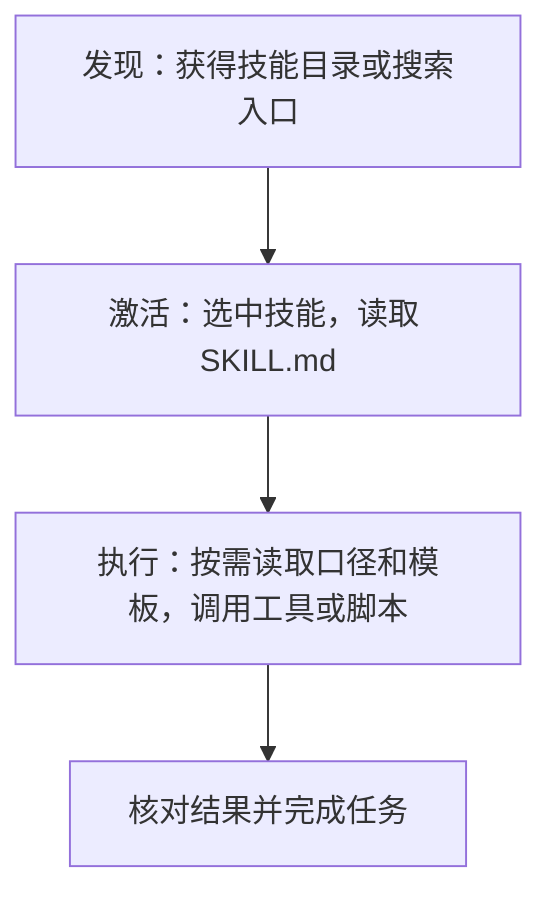

# Agent 工程实践：Skills 工作原理与规范编写

> 本文收录于 [AI-Engineering-Notes](https://github.com/xallor-ai/AI-Engineering-Notes)，分享 AI 技术研究、工程实践与应用探索。欢迎 Star 关注后续更新，也欢迎通过 Issue 交流和纠错。

## 1. Agent 为什么需要 Skill？

2025 年 10 月，Anthropic 在 Claude 中推出 Agent Skills，将完成特定任务所需的指令、脚本和参考资料组织成技能目录，供 Agent 按需发现和加载。同年 12 月，Agent Skills 被发布为开放标准，推动技能内容在不同 Agent 产品之间复用。[Anthropic 官方介绍](https://www.anthropic.com/engineering/equipping-agents-for-the-real-world-with-agent-skills)

为什么需要 Skill？

Agent 可以调用工具、规划并执行多步骤任务，但通用能力并不意味着它天然掌握特定团队的业务规则和操作方法。例如，同样是生成销售报告，不同团队可能采用不同的退款口径、日期字段和报告模板。每次通过提示词重新补充这些内容，既增加维护成本，也容易遗漏重要约定；始终将它们放进上下文，又会影响无关任务。

**Skill 将这些专业知识、操作方法和相关资源组织成可复用的能力单元，让 Agent 在需要时取得任务指引。**

这与 Workflow 并不冲突。Workflow 关注任务的执行路径，包括步骤、分支和检查点；Skill 关注完成某类任务所需的方法如何被封装、发现和复用。Workflow 中的 Agent 可以使用 Skill，动态规划任务的 Agent 也可以使用同一份 Skill。

本文以一个销售报告技能 `csv-report` 为例，从 Skill 的基本概念和组成结构出发，逐步讲解 Agent 如何发现和使用 Skill，以及怎样编写、安装和验证一份规范实用的技能。

## 2. Skill 是什么：组成、格式与规范

Agent Skills 是开放的内容组织格式；一个 Skill 则是按这种格式组织的**技能包**。它围绕一类任务保存操作指令，并可附带参考资料、脚本和模板，以 `SKILL.md` 为入口。

### 2.1 技能目录与必需入口

以本文假设的销售报告技能为例：

```text
csv-report/
├── SKILL.md                 # 技能入口与操作指引
├── references/
│   └── metrics.md           # 日期、金额和退款口径
├── assets/
│   └── report-template.md   # 报告模板
└── scripts/
    └── summarize.py         # 汇总与校验逻辑
```

**入口文件名固定为 `SKILL.md`**，放在技能目录根部。只有这个文件是必需的；简单技能可以只包含文本指令，不必附带脚本或创建空目录。

### 2.2 SKILL.md 由元数据和正文组成

文件开头是由两行 `---` 包裹的 YAML 元数据，称为 **frontmatter**；结束分隔符之后是 Markdown 正文。下面是一份精简示例，先展示格式，第四章再展开执行步骤：

```markdown
---
name: csv-report
description: 按团队口径统计销售额和退款，适用于销售 CSV 分析与报告任务。
---

# 销售 CSV 报告

统计前确认日期、币种及退款口径，结果中说明采用的规则与异常数据。
```

技能目录名要与文件中的 `name` 一致，例如这里两者都是 `csv-report`。这样目录路径与元数据使用同一个技能标识，便于校验、定位和跨工具迁移，避免出现“目录叫一个名字，文件里却声明另一个名字”的歧义。

元数据用于标识技能、描述适用场景和声明环境要求；正文告诉 Agent 如何完成任务。正文中的标题可以使用中文，不需要与 `name` 完全相同，也不能代替必需的元数据字段。

正文没有固定的章节名称要求，可以按任务组织步骤、输入输出示例、资源读取条件和失败处理。`## 工作步骤` 等标题是作者的组织方式，不是宿主必须识别的接口。

### 2.3 元数据字段有哪些约束？

| 字段 | 是否必需 | 格式与用途 |
| --- | --- | --- |
| `name` | 是 | 1–64 字符；使用规范允许的小写字母、数字和连字符；不能以连字符开头或结尾，不能含连续连字符；与技能目录名一致 |
| `description` | 是 | 1–1024 字符，不能为空；说明技能做什么、何时使用 |
| `compatibility` | 否 | 如填写，长度为 1–500 字符；说明解释器、系统命令、网络等环境要求，不会自动安装依赖 |
| `license` | 否 | 说明许可证名称，或引用技能包中的许可证文件 |
| `metadata` | 否 | 字符串键到字符串值的映射，可保存作者、版本等附加信息 |
| `allowed-tools` | 否 | 用空格分隔的工具声明字符串；属于实验性字段，支持方式取决于宿主，不能视为通用的权限授予机制 |

例如，`csv-report` 是合规名称，`CSV-Report`、`-csv-report`、`csv--report` 则不符合上述命名规则。

frontmatter 需要符合 YAML 语法：键值之间使用 `: `，嵌套字段采用一致的空格缩进。字符串包含可能被 YAML 解释为语法的内容时，应使用引号或块标量；例如 `metadata` 中的版本号应写成字符串 `"1.0"`，而不是数字 `1.0`。

以上字段约束以 [Agent Skills 格式规范](https://agentskills.io/specification#frontmatter) 为依据。某个客户端能够宽松读取不合规文件，并不意味着它符合可移植的格式要求。

### 2.4 可选资源怎样组织和引用？

| 推荐目录 | 放什么 | 本文示例 |
| --- | --- | --- |
| `references/` | 供 Agent 按需阅读的规则、说明和参考文档 | `metrics.md` 记录日期、金额和退款口径 |
| `scripts/` | 可运行的辅助逻辑，需说明依赖和使用方法 | `summarize.py` 执行汇总与校验 |
| `assets/` | 模板、图片和数据等任务资源 | `report-template.md` 规定报告样式 |

这些目录是推荐组织方式，不是必须全部创建的固定结构；技能还可以包含其他必要文件。正文引用资源时，以技能根目录为基准，例如 `references/metrics.md` 和 `scripts/summarize.py`。最好从 `SKILL.md` 直接指向所需资源，避免读者或 Agent 沿多层文档反复寻找。

引用路径只是告诉 Agent 去哪里取内容，不会自动读取或执行文件；正文仍需说明何时使用它们。具体工作目录、读取工具和执行权限由宿主决定。[资源组织与引用规范](https://agentskills.io/specification#file-references)

### 2.5 哪些是标准，哪些是编写建议？

| 类别 | 示例 | 怎样理解 |
| --- | --- | --- |
| 格式要求 | 必需入口、frontmatter、字段类型与名称约束 | 应按规范编写并校验 |
| 编写建议 | 控制正文长度、采用清晰步骤、资源按需拆分 | 帮助阅读与加载，不等于统一的运行限制 |
| 宿主实现 | 安装路径、技能发现方式、调用工具和权限策略 | 按实际客户端核查，不能由文件格式推断 |

例如，OpenClaw 的 `skills/csv-report/` 是该产品的发现位置示例，并不是 Agent Skills 标准规定的唯一安装目录；它的扩展元数据也不等于所有宿主都支持的字段。

接下来再看这些文件怎样被使用。负责模型调用、工具和技能加载的应用或运行环境称为**宿主**，第三章以 OpenClaw 为例说明它何时把技能内容提供给模型。

## 3. Skill 怎样被 Agent 使用？

### 渐进式披露：先知道有什么，再读取怎样做

如果安装十几个技能就把全部说明和参考资料都放进上下文，Agent 会先读到大量与当前任务无关的内容。**渐进式披露**将这个过程分成发现、激活、执行三个阶段：

| 阶段 | 提供给模型的内容 | 要解决的问题 |
| --- | --- | --- |
| 发现 | 技能名称、描述，以及宿主提供的定位信息或搜索入口 | 哪个技能可能与任务有关？ |
| 激活 | 选中技能的完整指令正文 | 这类任务应该怎样做？ |
| 执行 | 按需读取的参考资料、模板内容和工具执行结果 | 本次任务还需要哪些细节和结果？ |

重点是信息何时进入模型上下文。宿主程序可以提前扫描、解析或缓存文件，但这不等于已经把全文交给模型。加载后的正文、参考资料和工具结果仍会占用上下文，渐进式披露减少的是无关内容提前加载的负担。[官方加载设计](https://agentskills.io/client-implementation/adding-skills-support#the-core-principle-progressive-disclosure)

### 发现：OpenClaw 先筛选，再向模型提供入口

假设将 `csv-report` 放在 OpenClaw 工作区的 `skills/csv-report/` 中。OpenClaw 会发现技能，并结合配置、环境要求和可见性规则筛选。文件存在、宿主发现、模型可见，是三个不同状态。[OpenClaw Skills 文档](https://docs.openclaw.ai/tools/skills)

具体来说，OpenClaw 扫描技能目录找到 `SKILL.md`，解析 frontmatter 中的 `name`、`description` 等元数据，并结合文件位置建立技能目录，可类比为宿主完成的一次“登记”，而不是 Skill 主动执行注册。

在普通目录注入路径中，模型会获得名称、描述和读取位置。下面只展示结构，路径和技能内容均为教学示意：

```xml
<available_skills>
  <skill>
    <name>csv-report</name>
    <description>按团队口径分析销售 CSV 并生成报告。</description>
    <location>/workspace/skills/csv-report/SKILL.md</location>
  </skill>
</available_skills>
```

模型此时知道有一个销售报告技能，但还没有仅凭这条目录信息取得完整口径、脚本源码或模板。[OpenClaw 系统提示说明](https://docs.openclaw.ai/concepts/system-prompt#skills)

当前官方文档还描述了 Code Mode 的搜索入口：当搜索和读取能力可用时，可以省略提示词中的静态技能列表，通过 `skills.search(query)` 搜索当前会话已安装且符合资格的技能，再用 `skills.read(name)` 按精确名称读取。后台仍然进行发现和筛选；这个搜索不会查询 ClawHub、自动安装技能或授予执行权限。[已安装技能搜索](https://docs.openclaw.ai/tools/skills#search-installed-skills)

### 激活：任务相关时，读取完整操作说明

用户提出“按照团队口径分析这份销售 CSV，并说明退款影响”后，模型可以根据描述选择 `csv-report`，并通过宿主提供的入口读取 `SKILL.md`。

这一步取得的是操作说明：结合用户请求、输入数据和业务口径确定统计范围，再执行统计、组织报告、核对结果。模型是否选中它，还会受到描述、模型判断和宿主设置影响；“安装了”不代表“每次相关请求都一定触发”。

OpenClaw 也支持显式调用及控制模型自动调用的选项。这些属于宿主实现，不是 Agent Skills 格式对所有客户端的统一保证。[OpenClaw 调用控制](https://docs.openclaw.ai/tools/skills#optional-frontmatter-keys)

### 执行：根据正文指引，继续获取所需资源

计算销售额前，Agent 读取 `references/metrics.md`，确认日期、金额和退款口径。用户要求完整报告时，它再读取 `assets/report-template.md`。执行统计时，可以运行 `scripts/summarize.py` 并检查结果，而不必在每次运行前把全部源码放进上下文。

如果需要检查或修复脚本，Agent 也可以读取源码。关键是按任务需要取得内容，而不是发现一个技能后递归展开目录里的所有文件。[资源加载机制](https://agentskills.io/client-implementation/adding-skills-support#listing-bundled-resources)



这也解释了为什么技能作者不能只把资料放进文件夹：正文还要说明什么时候读、读完做什么、怎样判断任务完成。

## 4. 怎样编写一个规范的 Skill？

### 4.1 先确定任务边界

`csv-report` 的职责是按团队口径分析销售 CSV 并生成报告。它不需要同时负责通用文件转换、数据库维护或报告发布。这让描述更容易匹配任务，操作说明也更集中。

### 4.2 给出一份完整的入口文件

下面展示 `csv-report/SKILL.md` 的完整教学示例。它不是一个已经打包完成的可运行技能，实际使用前还需提供对应的口径文档、模板和脚本。

```markdown
---
name: csv-report
description: 按团队统计口径分析销售 CSV 并生成报告；用于统计销售额、分析退款或制作销售报告的任务，不用于一般 CSV 格式转换。
compatibility: Requires Python 3.10 or later.
---

# 销售 CSV 报告

## 输入与范围

优先从用户请求、现有数据和业务口径确定输入 CSV 的位置、统计期间、币种和输出位置；仅在必要信息仍缺失或存在影响结果的歧义时向用户确认。
保留原始数据，不把不同币种直接相加，不静默丢弃异常行。

## 执行步骤

1. 定位本技能目录，将已提供的输入路径解析为明确的位置。
2. 读取 references/metrics.md，结合用户请求和输入数据确定统计范围、日期、金额和退款口径。
3. 查看 scripts/summarize.py 的 --help，核对参数与执行依赖。
4. 按已确认的口径运行脚本，检查退出码、统计结果和异常数据说明。
5. 用户要求完整报告时，读取 assets/report-template.md 组织结果。
6. 核对统计期间、处理行数、排除行数及金额汇总，再交付结果。

## 失败与歧义处理

缺少必要字段或口径不明确时，列出具体问题，不自行猜测业务规则。
脚本失败时根据错误定位问题，不把不完整输出当作成功报告。

## 交付结果

提供统计结果、采用的口径、异常数据说明和生成文件的位置。
```

这个例子同时交代了四件事：什么任务适用、怎样执行、何时读取资源，以及怎样确认完成。它保存的是可复用方法，下一份 CSV 仍然可以沿用；具体文件位置、日期和币种由当前任务提供。

`description` 要在加载正文之前帮助 Agent 判断适用性。“处理数据”过于宽泛；“按团队口径分析销售 CSV”则能与格式转换等任务区分。正文中再详细的步骤，也不能替代入口描述的作用。[描述编写指南](https://agentskills.io/skill-creation/optimizing-descriptions)

### 4.3 把渐进式披露落实到写法

正文保留每次任务都需要知道的规则，把较长或低频使用的内容放进资源文件，并写清读取条件与用途。例如，统计前读取 `metrics.md` 确认口径，生成完整报告时才读取模板，比笼统写“详见 references”更明确。[官方编写建议](https://agentskills.io/skill-creation/best-practices)

官方以约 100 tokens 估计每个技能名称和描述的体量，并建议将完整 `SKILL.md` 正文控制在 5000 tokens 以下、主文件控制在 500 行以下。前者是量级估计，后两者是编写建议，不是所有宿主统一执行的硬性限制。[渐进式披露规范](https://agentskills.io/specification#progressive-disclosure)

### 4.4 附带脚本时，写清调用约定

Skill 不一定需要脚本。已有工具能完成任务时，说明怎样使用即可；对于反复出现的金额汇总或结果校验逻辑，可以提供可复用、可测试的脚本。

作者需要写清的是执行约定：

| 要说明的事项 | 销售报告示例 |
| --- | --- |
| 何时运行 | 确认统计口径和必要字段后再运行汇总脚本 |
| 输入与依赖 | CSV 路径、统计期间、币种，以及所需解释器和软件包 |
| 路径基准 | 脚本相对于技能目录定位，用户数据与输出位置单独解析 |
| 结果与失败 | 输出格式、生成文件位置、退出码，以及异常数据怎样报告 |

资源引用以技能根目录为解析基准；宿主可以安排从该目录执行命令，也可以指导 Agent 在工具调用中使用绝对路径。用户输入和输出路径则需按任务单独定位，不能因脚本所在目录而改变含义。格式标准本身也不会安装运行依赖。[路径处理](https://agentskills.io/client-implementation/adding-skills-support#behavioral-instructions)

脚本宜提供 `--help`，避免依赖交互式提示；结构化结果与诊断信息分开输出，并用退出码表示执行状态。这里关注的是 Agent 怎样可靠地调用它，具体语言实现和依赖管理可按需查阅[官方脚本指南](https://agentskills.io/skill-creation/using-scripts)。

## 5. 去哪里发现、安装和验证 Skill？

本章结合 OpenClaw 的 ClawHub 与 Vercel 的 skills.sh 介绍技能发现入口，以 Vercel Skills CLI 演示搜索和安装，再说明如何在目标 Agent 中验证可用性与实际效果。

### 5.1 发现与筛选候选技能

可以先看目标产品的内置技能、文档列出的示例和能力维护者发布的仓库；再通过 GitHub 或社区目录查找与任务相关的技能。OpenClaw 的 ClawHub 和 Vercel 的 skills.sh 都提供发现入口，但它们不等于 Agent Skills 格式标准本身。[OpenClaw 技能来源](https://docs.openclaw.ai/tools/skills#installing-from-clawhub) · [Vercel skills CLI](https://github.com/vercel-labs/skills)

围绕销售分析任务，可以使用 Vercel CLI 搜索候选项：

```bash
npx skills find "sales csv report"
```

搜索结果不代表本文假设的 `csv-report` 已经存在。选择候选项时，应阅读其描述和正文，确认统计能力、依赖、脚本行为以及与当前客户端的适配情况，再决定是否安装。

### 5.2 安装到目标客户端

该 CLI 的安装语法如下，尖括号部分需替换为实际候选信息：

```text
npx skills add <owner>/<repo> --skill <skill-name>
```

它默认按项目安装；目标 Agent、作用域和选项按工具文档选择。安装器把文件放到某个位置，不等于当前客户端已经发现和加载了它，安装后仍要在实际使用环境中验证。[安装说明](https://github.com/vercel-labs/skills#install-a-skill)

### 5.3 检查格式与实际可用性

先做格式与资源检查：frontmatter 能否解析，名称是否符合规范，文中提到的文件是否存在，脚本能否在声明的环境中运行。官方参考校验器可检查格式和命名，但不能替代业务验证。[格式校验](https://agentskills.io/specification#validation)

这些检查用于确认基本格式和运行前提。实际可用性还取决于目标客户端能否发现和读取技能，以及当前执行环境是否满足所需权限与依赖；这些条件满足后，还要验证它是否真正帮助任务。

### 5.4 验证触发与执行效果

分别检查触发与执行：

| 检查维度 | 测试请求或数据 | 观察结果 |
| --- | --- | --- |
| 应当使用 | “按团队口径汇总本月销售，并说明退款影响” | 是否加载相关 Skill、读取业务口径 |
| 不必使用 | “把这份 CSV 转成 JSON” | 是否避免引入无关的销售分析流程 |
| 正常任务 | 有明确日期、币种和退款字段的数据 | 汇总结果是否正确，统计范围是否一致 |
| 边界任务 | 缺少金额列、混合币种或包含异常行的数据 | 是否指出具体问题，避免静默漏算或错误合并 |

描述优化要包含容易混淆的反例，并观察多次运行中的实际加载行为；一次触发成功不能证明稳定性。[触发评估](https://agentskills.io/skill-creation/optimizing-descriptions)

质量评估则把同一任务在“使用 Skill”和“不使用 Skill”或“使用旧版本”下的结果作对照。检查金额、行数、输出文件，也检查执行轨迹：是否漏读口径、重复尝试无关工具，或增加了不必要的步骤。对于可计算的结果，优先用程序或独立计算验证，同时记录时间和上下文成本。[输出质量评估](https://agentskills.io/skill-creation/evaluating-skills)

对于销售报告技能，价值最终体现在退款口径是否正确、异常数据是否被发现，以及新一份数据到来时能否继续可靠工作。把这些任务反馈用于修正描述、步骤和资源说明，才能让一份格式合格的 `SKILL.md` 逐渐成为有用的能力单元。
